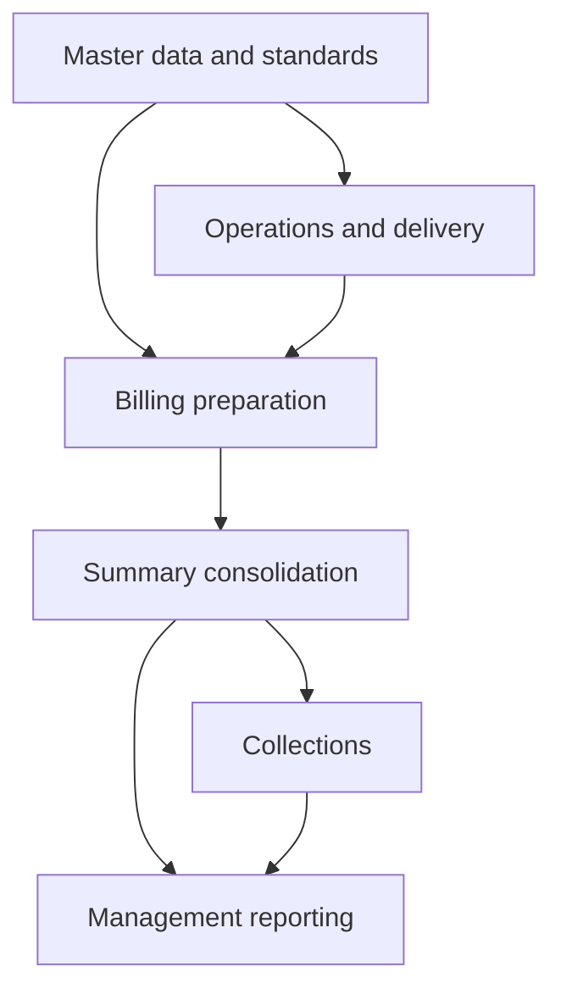

# Jumpin Wash — Google Workspace ERP

Running a laundry business means connecting what was picked up, what was processed and delivered, what can be billed, and what still needs to be collected. I built Jumpin Wash’s Google Workspace systems to carry that information across operations, billing, payroll, and management reporting.

I’m self-taught in building these systems. As operating needs evolved, the work grew into connected modules: specialized workbooks, shared references, spreadsheet formulas, and Apps Script. A workbook’s output becomes useful when the next process can use it—and when I can follow a reported number back to its source.

**Platform:** Google Sheets, Apps Script, Forms, Drive, and Gmail.

*Functional overview from module documentation.*

## Business impact

On-ground assessments with the workforce indicated billing turnaround moved from roughly **2–3 months to under one week**, and payroll preparation from **about one workday to two hours**. These are workforce assessments, not formal timing-study results.

## Explore the system

Start with [the business relationships](docs/business-data-model.md#1-business-relationships), then [how the workbooks connect](docs/architecture.md). A **Service Order Slip (SOS)** represents one pickup form. Pickup date determines its billing cutoff; all items must be delivered before that pickup can be billed.

| Follow this story | What you can inspect |
|---|---|
| [Billing and collections](docs/case-studies/billing-and-collections.md) | Customer pricing, monthly file preparation, service amounts, consolidation and status tracking |
| [Production standards](docs/case-studies/production-standards.md) | Shared item definitions, new-item mapping, overrides and processing parameters |
| [Executive reporting](docs/case-studies/executive-reporting.md) | Reporting inputs, management outputs and PDF/email distribution |

For technical depth, inspect the [formula walkthrough](examples/formula-exhibits.md), [original automation helpers](src/README.md), and [data lineage](docs/data-model-and-lineage.md). The [proposed relational design](docs/business-data-model.md#3-proposed-relational-design) expresses the business relationships as tables and constraints; it is new portfolio analysis, separate from the deployed Google Workspace implementation.

## Scope

The walkthroughs focus on billing, production standards, and reporting; payroll is part of the wider system but has no dedicated implementation walkthrough here. Selected source-derived formulas and historical documentation support different levels of detail; see [verification scope](docs/verification.md). Production records and private configuration are excluded. This is system documentation, not a complete deployment package. AI assisted documentation preparation and review.

The [selected original automation helpers](src/README.md) include six isolated checks and explain the surrounding file-preparation and reporting workflows.
