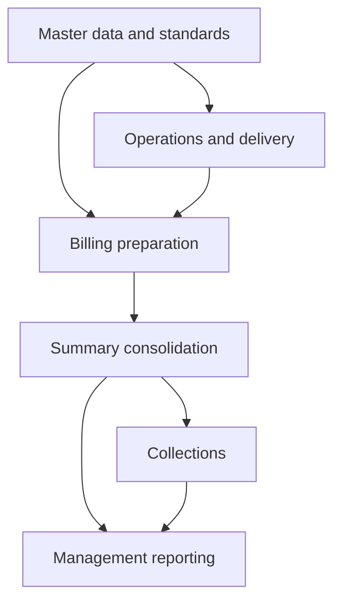

# Jumpin Wash — Google Workspace ERP

Running a laundry business means connecting what was picked up, what was processed and delivered, what can be billed, and what still needs to be collected. I built Jumpin Wash’s Google Workspace systems to carry that information across operations, billing, payroll, and management reporting.

I’m self-taught in building these systems. As operating needs evolved, the work grew into connected modules: specialized workbooks, shared references, spreadsheet formulas, and Apps Script. A workbook’s output becomes useful when the next process can use it—and when I can follow a reported number back to its source.

**Platform:** Google Sheets, Apps Script, Forms, Drive, and Gmail.

*Functional overview from module documentation.*

## How to read this system

**Start with [the business records and relationships](docs/data-model-and-lineage.md).** The opening separates accounts, service work, items, prices, bills and status updates from the files that hold them. Then follow [the architecture walkthrough](docs/architecture.md): what each workbook holds, what its formulas or scripts do, and what the next workbook receives. Detailed formula traces remain optional.

Then follow the parts you want to examine:

- **[Billing and collections](docs/case-studies/billing-and-collections.md):** how service records become statements, consolidated outputs, and billing status.
- **[Production standards](docs/case-studies/production-standards.md):** how item references select shared processing parameters while allowing specific exceptions.
- **[Executive reporting](docs/case-studies/executive-reporting.md):** how specialized reporting outputs become a management view.

The [formula walkthrough](examples/formula-exhibits.md) opens up registry-driven imports, central price projections and configured reference ingestion. You can understand the overall design first, then inspect its mechanics.

On-ground assessments with the workforce indicated billing turnaround moved from roughly 2–3 months to under one week, and payroll preparation from about one workday to two hours—not formal timing-study results.

## Scope

The walkthroughs focus on billing, production standards, and reporting; payroll is part of the wider system but has no dedicated implementation walkthrough here. Selected source-derived formulas and historical documentation support different levels of detail; see [verification scope](docs/verification.md). Production records and private configuration are excluded. This is system documentation, not a complete deployment package. AI assisted documentation preparation and review.

The [selected original automation helpers](src/README.md) include six isolated checks and explain the surrounding file-preparation and reporting workflows.
