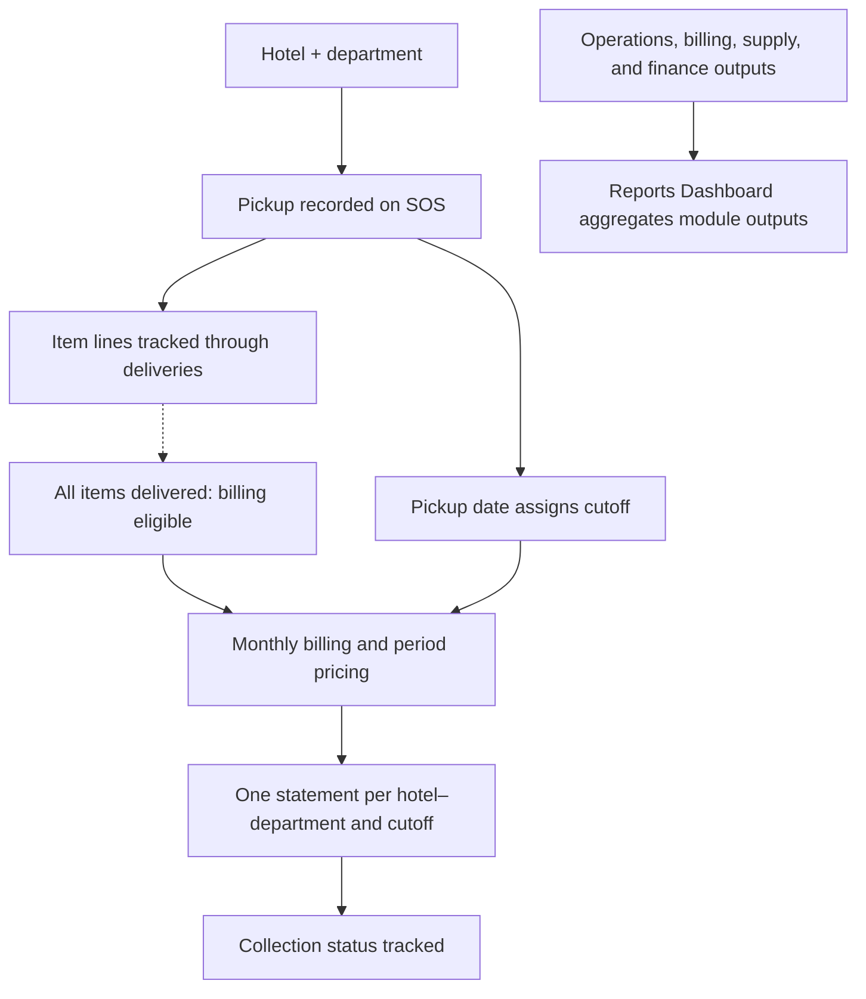

# Jumpin Wash — Commercial Laundry Operations System

Jumpin Wash is a commercial laundry serving hotels. Its operating system keeps each hotel–department’s linen service connected from pickup and delivery through billing and collection follow-up, while giving management views across operations and finance.

The central control uses **two clocks**: all items on a pickup must be delivered before that pickup is billable; the pickup date determines its billing cutoff. A June 14 pickup completed June 18 belongs in the June 1–15 statement. Each hotel–department receives one Statement of Account per cutoff. These are owner-confirmed operating rules.

*Business lifecycle and separate aggregate reporting view. The delivery gate is an owner-confirmed rule; automatic enforcement has not been verified.*

## What the system does

The Google Workspace implementation connects pickup/service records, delivery and linen-balance records, monthly billing workbooks, hotel–department summaries, a Billing Tracker, and management reporting. Billing preparation uses local period pricing; the Tracker records dated validation, acceptance, and payment statuses. The Reports Dashboard presents aggregate module outputs. Some KPI formulas and their exact lineage remain untraced.

The system grew through specialized workbooks, shared references, spreadsheet formulas, and Apps Script. This repository follows how information moves between those parts and shows selected formulas, scripts, business relationships, and verification limits. Its proposed relational design is portfolio analysis, not a deployed database or an ERP rebuild.

## Reported business impact

On-ground assessments with the workforce indicated billing turnaround moved from roughly **2–3 months to under one week**, and payroll preparation from **about one workday to two hours**. These are workforce assessments, not formal timing-study results.

## My contribution

I built the original Google Workspace production system and evolved it as operating needs changed. The project span of 2021–2026 is user-reported; available evidence does not date or attribute every later enhancement individually. The 2026 portfolio review mapped selected source-grounded business relationships, inspected formulas and Apps Script, and documented a proposed relational design. AI assisted this documentation and source review; it did not build the original system.

## Explore the evidence

Follow the business flow in this order:

| Step | What to inspect |
|---|---|
| 1. [Billing and collections](docs/case-studies/billing-and-collections.md) | Customer pricing, monthly file preparation, service amounts, consolidation and status tracking |
| 2. [Production standards](docs/case-studies/production-standards.md) | Shared item definitions, new-item mapping, overrides and processing parameters |
| 3. [Executive reporting](docs/case-studies/executive-reporting.md) | Aggregate reporting inputs, management outputs, PDF/email distribution, and limits in KPI lineage |

For a concise handoff walkthrough, see [How pickup, billing, collections, and reporting connect](docs/implementation-walkthrough.md). The [business relationships](docs/business-data-model.md#1-business-relationships) explain the source basis for SOS, delivery, billing, and cutoff rules; [how the workbooks connect](docs/architecture.md) documents module relationships.

For implementation detail, inspect the [formula walkthrough](examples/formula-exhibits.md), [selected original automation helpers](src/README.md), and [data lineage](docs/data-model-and-lineage.md). The [proposed relational design](docs/business-data-model.md#3-proposed-relational-design) expresses business relationships as tables and constraints; it is separate from the deployed Google Workspace implementation.

## Scope and verification

The walkthroughs focus on billing, production standards, and reporting; payroll is part of the wider system but has no dedicated implementation walkthrough here. Selected source-derived formulas and historical documentation support different levels of detail; see [verification scope](docs/verification.md). Production records and private configuration are excluded. This is system documentation, not a complete deployment package. The selected Apps Script helpers have six isolated checks; they do not constitute a production test.