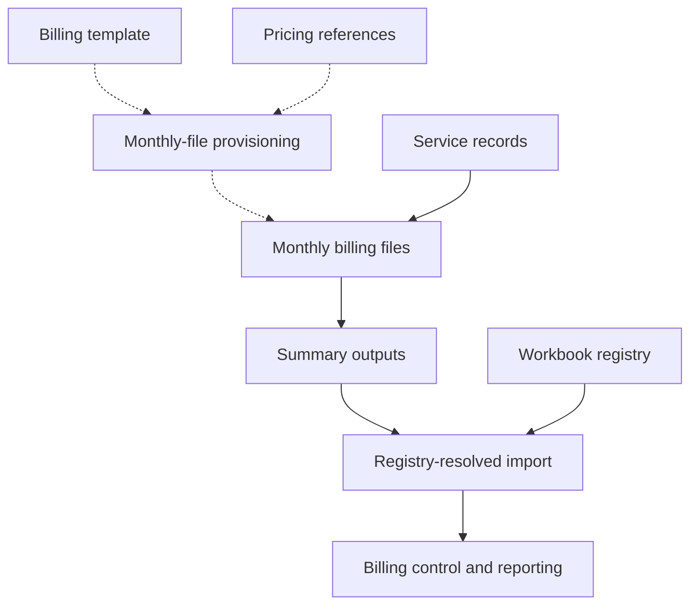

# How the workbooks connect

A laundry pickup starts an operational job, but the information has to keep moving after the linen leaves the customer. Quantities support production planning and delivery checks. Service records and prices support billing. Bill status supports collection follow-up. Management needs to see those activities together.

I built connected workbooks around these responsibilities. To understand the structure, start with what each part handles, then follow what it passes to the next part. The individual formulas make more sense once those boundaries are clear.

## What the files do

A **hotel–department** is one hotel account and operating department, such as housekeeping; the billing structure distinguishes those combinations. A **service record** holds information about laundry work, including item quantities and pickup or delivery details. A **reference** supplies a reusable definition or parameter, such as an item name, price, or processing standard. A monthly billing workbook serves one hotel–department and month. A **Summary** workbook consolidates the monthly outputs for that hotel–department across the year. A **registry** maps configured names to workbook locations. A **process alias** is a reusable key for a processing definition. An **override** supplies an item-specific replacement; the **effective alias** is the key selected after that choice.

The map below combines historical module documentation with selected current formula inspections. “Holds” describes a workbook’s responsibility, not a guarantee of exclusive ownership or enforced access controls.

| Business responsibility → file/module | Data held or consumed | Calculation or function | Output and use |
|---|---|---|---|
| Define billable items and prices → **Hotel Pricing** | Standard item names and customer pricing | Provides the documented authoritative item names and pricing references | Common item definitions; pricing copied into monthly billing files as documented period snapshots |
| Define processing references → **Loading Standards** | Standard items, item-to-process mappings, alias overrides, washer/dryer parameters | Resolves an effective process alias, looks up parameters, and classifies item text | Reusable processing references and weight calculations, subject to the unresolved units described below |
| Capture and follow laundry work → **pickup capture, machine logs, packing, and linen balance modules** | Pickup quantities, processing records, packing and delivery information | Capture activity and support operational follow-up | Service information used in planning, delivery/balance views, billing, and reporting; detailed edges remain documented rather than fully traced |
| Estimate production work → **Night Shift Planning** | Operational demand and loading/process standards | Supports load and capacity estimates | A production plan/checklist; historical adoption was limited, so the plan is not treated as proof of execution |
| Assemble a bill → **monthly billing workbooks** | Service worksheets, billing-period configuration, and price references | Selected formulas choose service records by pickup day, retrieve fields, look up prices, and calculate amounts | Monthly statement fields and totals |
| Consolidate monthly activity → **Summary workbooks** | Monthly billing and delivery-balance outputs for one hotel–department | Documented annual consolidation across monthly files | Standardized billing and balance outputs for downstream modules |
| Prepare billing files and consolidate across accounts → **Billing Grabber** | Customer configuration, billing cycles, template/folder mappings, Summary locations and billing outputs | Documented template generation and period pricing copy; inspected registry lookup and external import | Monthly billing workbooks; consolidated billing outputs for control and reporting |
| Follow collection progress → **Billing Tracker and Collectibles** | Bill references, status updates, and outstanding amounts | Historically documented timestamped status history and latest-status selection | Validation, acceptance, payment, and collection-follow-up views |
| Bring financial results into management review → **Payroll Admin, Expense Tracker, Financial Integrator, and Revenue Cost vs KG** | Payroll/expense information and financial or operating outputs | Separate preparation, financial consolidation, and revenue/cost-per-kilogram reporting responsibilities | Financial reporting inputs; this page does not establish every calculation or dependency |
| Assemble and distribute the management view → **Reports Dashboard** | Reporting outputs from operations, billing, supplies, and financial modules | Documented local summaries/comparisons, PDF export, and email distribution | The Jumpin Dashboard worksheet and executive report |

The point of this map is the handoff: a statement total, a processing parameter, and a payment status answer different questions. They should not be mistaken for interchangeable versions of the same record.

## Preparing files is different from moving operational data

The monthly billing process has a setup path as well as a recurring data path. Historical documentation assigns both responsibilities to Billing Grabber, but they use different mechanisms.

*Dashed edges describe the file-setup path now supported by recovered script source. Solid edges describe the operational/consolidation path; only selected formula edges have been inspected. The diagram does not certify every connection.*

Provisioning means preparing monthly files from a template and supplying their period-specific references. The recovered setup source copies templates, maps customer fields by headers, selects billing-period sheet visibility, and copies pricing values and selected formatting. File distribution includes copies, archiving and staging cleanup; it has no rollback. By contrast, the recurring Summary import has an inspected formula: it constructs a lookup key, resolves the workbook through a registry, and reads its billing-output row. That formula does not itself create monthly workbooks.

## Follow the connections

Here are the mechanisms behind selected handoffs. “Observed” means formula text was inspected, not that the full workflow was executed during this review.

| Source | Mechanism | Destination | Output or use | Evidence |
|---|---|---|---|---|
| Standard item-name reference | Worksheet reference into the item field | Loading Standards | Common input to process mapping | Observed selected formulas |
| Item/process mapping plus optional override | Exact-match lookup, then nonblank-override precedence | Effective alias in Loading Standards | One key drives washer/dryer parameter retrieval | Observed selected formulas |
| Process-details reference | Exact-match lookups by effective alias | Loading Standards parameter fields | Washer/dryer loading-quantity fields and processing minutes; quantity-field units are not established by this trace | Observed selected formulas |
| Billing template and pricing references | Documented monthly-file generation and pricing copy | Monthly billing workbooks | Prepared billing files with period pricing snapshots | Recovered source inspected; not executed |
| Service worksheets and reference table | Pickup-day selection and dynamic worksheet addressing | Monthly statement | Selected service fields and amounts | Observed selected formulas |
| Summary workbook registry and billing-output row | Exact-match `VLOOKUP` resolves location; `IMPORTRANGE` retrieves output | Billing Grabber consolidation | Imported row for a configured Summary | Observed selected formula |
| Monthly billing → Summary → billing status/collections | Documented consolidation and status-processing relationships | Summary, Billing Tracker, and collection views | Bill-level follow-up and outstanding-work views | Historical documentation; complete current path untraced |
| Operational, billing, supplies, and financial reporting outputs | Documented imported references and local summaries | Reports Dashboard | Combined management view and PDF/email report | Historical documentation; export/email source inspected; selected KPI formula gaps remain |

Hotel Pricing is the documented authority for standard item names. In the inspected formulas, Loading Standards reads a local standard-name reference sheet and looks up processing parameters in its own Item Process Details sheet. The external item-name edge is also traced: URL Sources configures Hotel Pricing’s standard-label column, imported into the reference worksheet before local mapping.

These connections show how reference data and transaction outputs can be reused across files. They also make source layouts, configured names, access permissions, and reference quality part of the system’s dependencies.

## Where the next layer matters

There are important distinctions behind this overview. Historical documentation describes delivery-date entry as a billability gate, but the selected statement path has not established that dependency. One Summary kilogram-analysis consumer has been traced to the static weight references; other consumers and agreement with the dynamic section remain unresolved. The alternate weight field’s units also need clarification before its calculation can be explained as dimensionally correct.

Those details belong beside the relevant mechanism, rather than being assumed from the diagram. Continue to [data model and lineage](data-model-and-lineage.md), then the [billing workflow](case-studies/billing-and-collections.md), [production standards](case-studies/production-standards.md), and [executive reporting](case-studies/executive-reporting.md). The [verification record](verification.md) collects the inspection and execution boundaries.
