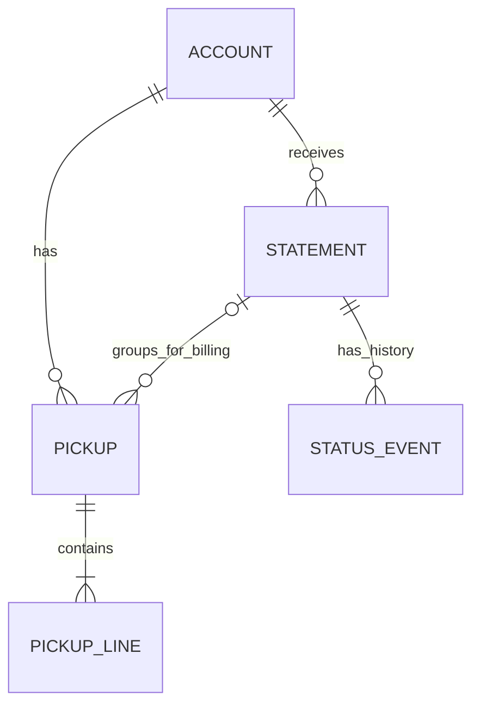
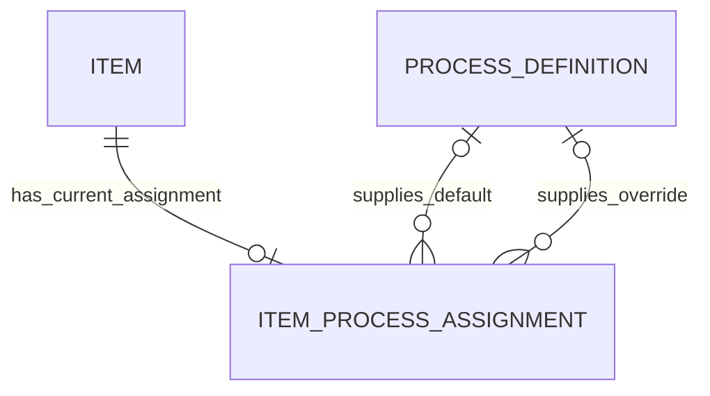
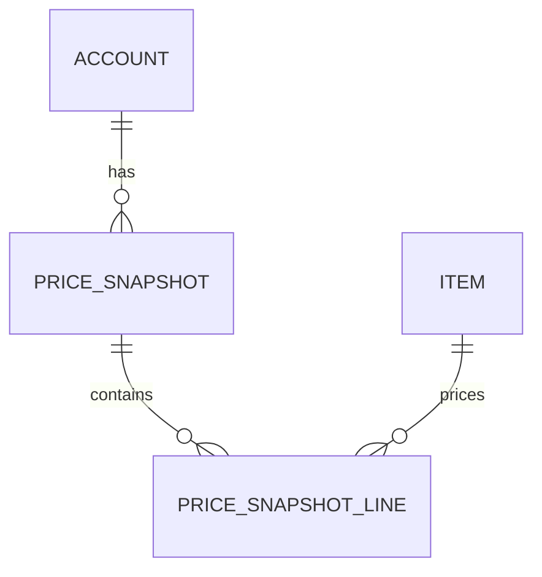
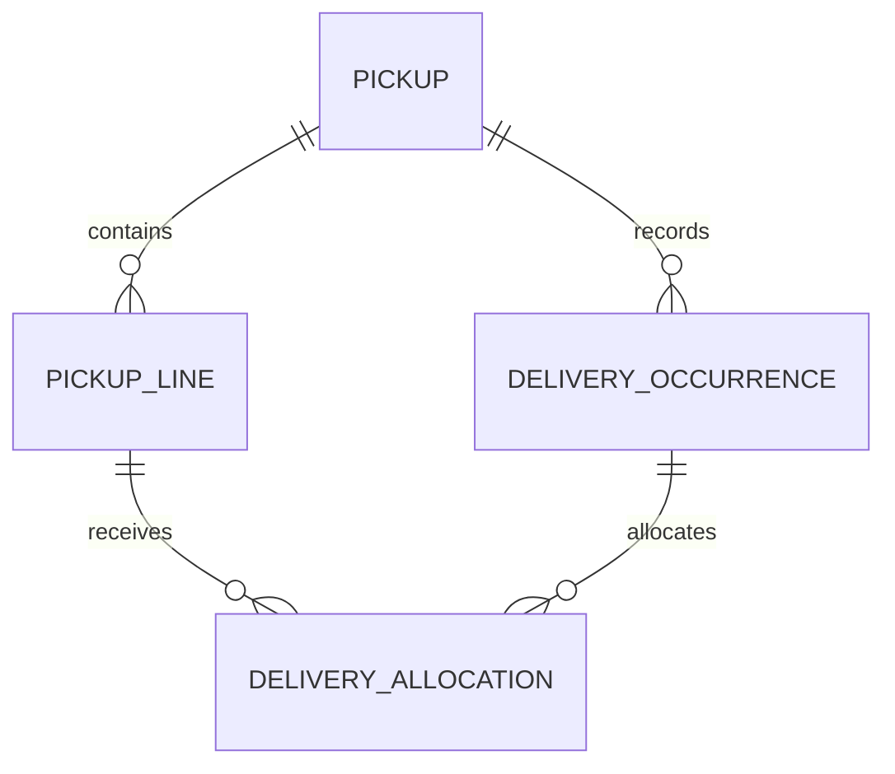

# The data model behind Jumpin Wash

Business relationships, implementation mapping and proposed relational design

I built the system around a practical question: how does a hotel’s pickup become a bill, and how can we follow that bill through collection? Shared item definitions and processing standards connect that work to production planning. Reporting then summarizes the operational records and billing progress.

This page separates the business relationships implemented through Google Workspace from a proposed relational design derived from them. The database tables and constraints below are new portfolio design work; no SQL database has been deployed.

## 1. Business relationships

A hotel–department account has Service Order Slips (SOS), each representing one pickup form and containing item quantities. Partial deliveries reduce those quantities’ outstanding balances. Complete delivery makes the pickup eligible for billing. Its pickup date determines which cutoff statement it belongs to.

For example, a June 14 pickup completed on June 18 still belongs to the June 1–15 statement. Delivery completion does not move it into the next billing period. Each account has one Statement of Account per cutoff, and status updates track that statement’s progress.

This is a reconstructed business model, not a diagram of enforced Sheets constraints. PICKUP means a populated pickup form, so it contains at least one line. An unbilled pickup can have no statement assignment. Statement/status association follows the owner-confirmed one-statement-per-account/cutoff rule; the current Tracker matches account/month/cutoff within an annual workbook rather than statement reference. Reissues and exceptional corrections are outside this normal-path model.

| Rule | Basis |
|---|---|
| One Service Order Slip (SOS) represents one pickup form | Workbook operating instructions |
| Partial deliveries are recorded against pickup item lines | Inspected worksheet structure and balance formulas |
| All items in a pickup must be delivered before billing it | Owner-confirmed operating rule, also described in documentation |
| Pickup date determines the billing cutoff, even with later delivery | Owner confirmation; inspected period selection uses pickup-day bounds |
| One statement per account/cutoff | Owner confirmation |
| Status history is separate from billing quantities | Inspected Tracker fields/formulas and documented workflow |

The delivery-completion rule is a business requirement. Inspection of selected formulas does not establish that every billing path automatically enforces it.

## 2. Shared references

### Processing standards

Items select a mapped process alias unless a nonblank override takes precedence. The effective alias retrieves shared loading quantities, processing times and other parameters.

The diagram expresses a proposed current-state design: at most one assignment row per item, with optional default and override references. At least one valid reference is needed for a usable assignment. This does not assert that existing mapping rows or aliases are unique. Effective process is derived from override precedence; it is not another entity.

### Customer pricing

Central pricing projects customer-specific item/rate views. The monthly setup script copies those values into local billing files, whose formulas use them to calculate line amounts.

Snapshot identity is proposed. Current monthly copies are editable: changing local rates can change earlier SOS amounts. The instructions therefore warn against mid-cycle price changes. Copied values are not proof of immutable price history or frozen issued-bill amounts.

ITEM is a proposed canonical reference between pricing, pickup lines and processing. The production import points directly to Hotel Pricing’s standard-label column, and selected central pricing inputs use validation against that column. However, the live profile found a duplicate master display label, a duplicate processing alias with different parameter rows, and three labels in the sampled monthly price list absent from the current master. The sampled local price labels were unique, and every populated item line in the selected SOS matched that local list. These are bounded current-state results, not a historical census.

The existing system’s name-based relationships must therefore be preserved as source relationships, not replaced by an assumed global ITEM key. A proposed canonical ID needs explicit source-to-item mapping, treatment of service variants and duplicate resolution. In particular, an exact VLOOKUP uses the first matching process row: selecting a different row for the duplicated alias would change the retrieved parameters.

## 3. Proposed relational design

All IDs, primary/foreign keys and constraints here are proposed. They make the relationships explicit without claiming that Sheets already enforces them. PK means primary key; FK means foreign key.

### Operational records

| Relation | Proposed key | Principal attributes / references |
|---|---|---|
| Account | account_id | account_label; no assumed global uniqueness of names |
| Pickup | pickup_id | account_id FK, pickup_date, external_pickup_reference, delivery_receipt_reference, nullable statement_id FK |
| PickupLine | (pickup_id, line_no) | item_id FK, quantity, quantity_unit |
| DeliveryOccurrence | (pickup_id, delivery_no) | delivery_date |
| DeliveryAllocation | (pickup_id, delivery_no, line_no) | delivered_quantity; composite FKs to the corresponding occurrence and pickup line |
| Statement | statement_id | account_id FK, billing_year, billing_month, cutoff_code, reference_no, statement_date |
| StatusEvent | event_id | statement_id FK, append_sequence, recorded_at, status, observed_amount, optional receipt_reference and commitment_date |

DeliveryOccurrence means a dated delivery slot within one pickup, not a truck trip or a globally identified delivery document. A delivery allocation must reference a line and occurrence from that same pickup. Turning the five physical delivery columns into rows removes the storage limit without claiming that more deliveries currently occur.

This storage view permits a draft pickup with no lines; the business view above describes populated pickup forms. Full composite keys preserve same-pickup allocation membership. Balance is derived from picked-up quantity minus allocated deliveries, using compatible units.

The proposed Statement alternate key is `(account_id, billing_year, billing_month, cutoff_code)`, reflecting one logical statement per account/cutoff. Statement reference-number uniqueness is not assumed. A pickup’s nullable statement_id supports unbilled work and normal whole-pickup billing; partial-quantity billing is excluded by the confirmed business rule. Same-account membership, correct pickup-period assignment and full-delivery eligibility require validation beyond a foreign key.

The period grouping and eligibility condition are distinct: pickup_date identifies the statement period, while full delivery permits billing. This model does not decide whether the entire statement must wait for an incomplete pickup or how exceptional reissues are handled.

### Reference records

| Relation | Proposed key | Principal attributes / references |
|---|---|---|
| Item | item_id | item_code, description; derive display label |
| ProcessDefinition | process_id | alias (not assumed unique), washer_quantity, washer_minutes, dryer_quantity, dryer_minutes, flatwork_parameter |
| ItemProcessAssignment | item_id PK/FK | mapped_process_id nullable FK, override_process_id nullable FK |
| PriceSnapshot | snapshot_id | account_id FK, billing_period, captured_at, optional source_revision_note |
| PriceSnapshotLine | (snapshot_id, item_id), conditional | unit_price, price_basis |

Canonical Account and Item identities require reviewed mappings from source workbook context, source label and where necessary source row/variant. Account names are matched by substring in the pricing script, exact values in some formulas and trimmed values in others; no single enforced account key exists across those paths. Source provenance belongs in private evidence, not public production URLs.

One-rate-per-item-per-snapshot is an assumption to validate. If variant or price basis distinguishes multiple rates, it must participate in the key or reference a separately identified price entry. More than one snapshot per account/period remains possible for corrections. No automatic mapping from a statement to a particular historical price revision has been demonstrated. Extracting logical snapshot lines must separate actual item/rate rows from copied headers, account selectors and revision metadata, and detect duplicate rates rather than silently choosing one.

### Why separate these relations?

| Dependency under the proposed design | Reason for separation |
|---|---|
| process_id → process parameters | Shared parameters belong with the process, rather than being repeated on every item |
| item_id → default and override process references | Item-specific selection is separate from shared process definitions |
| snapshot_id → account, capture time and period context | Capture metadata belongs once per copied price set |
| (snapshot_id, item_id) → rate, subject to the rate-grain assumption | Prices depend on account/snapshot context, not globally on item alone |
| (pickup_id, delivery_no) → delivery_date | A delivery-slot date is stored once, independently of its line allocations |
| (pickup_id, delivery_no, line_no) → delivered_quantity | Quantity belongs to one line’s allocation in that delivery slot |
| event_id → statement, ordering and status observation | Historical events are separate from the derived current status |

These decompositions reduce repeated facts and the risk of inconsistent updates. Parent keys and valid foreign keys allow child rows to regain their context without multiplying matches; reconstructing pickups with no deliveries requires outer joins. Dependencies and business keys still need validation before assigning a normal form to the entire design. This is not a whole-system 3NF certification.

## 4. How Google Workspace implements the model

| Business meaning | Existing implementation | Design consequence |
|---|---|---|
| Account context | Customer Details, account labels and workbook partitioning | File location supplies context; it is not a durable business key |
| Pickup and item lines | SOS tabs with quantity, item, rate and amount fields | One physical form holds several logical record types |
| Partial deliveries | Dated delivery columns and line-balance formulas | Proposed occurrence/allocation rows express the repeated structure |
| Statement | Period-specific billing tabs, reference number and statement date | Pickup-day bounds select membership; complete-delivery eligibility remains a separate rule |
| Shared item/process reference | Imported standard labels, mapping worklist, override and parameter lookups | Reference reuse with explicit override precedence |
| Customer prices | Central projections → script value copy → local Price List → line lookup | Distributed editable snapshots; no demonstrated immutable price binding |
| Status events | Billing Status Entries and updater interfaces | Events match account/month/cutoff in annual context; no direct statement-reference FK |
| Current status | Maximum matching physical row in inspected formulas | Latest-by-row, not latest timestamp; reordering can change the result |
| Reporting | Conditional imports, summaries, wide-to-long reshaping and status association | Derived views with their own account/period/item/category grain |

A proposed append_sequence would preserve captured row order when moving events into relations. It should not be initialized by sorting Entry # or timestamps: those fields do not control the inspected current-status calculation. Updater dropdowns restrict entered status values but do not establish enforced transition order or immutable history. Matching is not uniform: the inspected long-form grouping uppercases month and trims its subsequent association, while the matrix INPUTS path uses direct comparisons.

## 5. Relationship-to-source check

This register records the basis for every diagram edge. Worksheet names and cells identify the mechanism without exposing production links or data. Observed means selected source inspected; confirmed means the owner supplied the business rule; proposed means a new logical representation or constraint.

| Diagram relationship | Source mechanism | Conclusion |
|---|---|---|
| Account → Pickup | Customer Details; SOS1 F4/I4; account-specific monthly workbook context | Observed account context; proposed account_id requires label mapping |
| Pickup → PickupLine | Instructions D8; SOS1 E9:P10 and repeated line rows | One form per pickup confirmed by instructions; populated form contains lines; PKs proposed |
| Account → Statement | Period billing tabs reference Customer Details and carry reference/date fields | Observed context; one statement/account/cutoff owner-confirmed |
| Statement → Pickup | REFERENCE - SOS vs Pickup B3:B4 reads pickup date/day; BILLING - 1to7 E14 selects SOS indices by bounds | Observed period membership; full-delivery eligibility owner-confirmed, not proved by selector alone |
| Statement → StatusEvent | Billing Status Entries D:F; INPUTS C4; Table Form A3/J3; annual workbook context | Reconstructed via account/year/month/cutoff plus one-statement rule; direct FK proposed |
| Item → ItemProcessAssignment | Loading Standards URL Sources C2:D2; reference import A2; Load Parameters A2:B2 | Master-to-production dependency observed; duplicate labels prevent treating label as unique identity |
| ProcessDefinition → default / override | Load Parameters B2/C2/D2 and E2:I2; Item Process Details | Lookup and override precedence observed; optional FKs and row identities proposed; duplicate alias has differing parameters |
| Account → PriceSnapshot | Customer selector G1 and projection A2:B2; recovered updatePriceList() | Customer-specific projection and value copy observed; capture identity/history constraints proposed |
| PriceSnapshot → PriceSnapshotLine | Local Price List A:B stores copied item/rate rows | Observed rows; extraction and one-rate key conditional; snapshot metadata is not a price line |
| Item → PriceSnapshotLine | Selected central Price List validation references Std Item Names C2:C; local line lookup matches item text | Partial domain linkage observed; local/master differences require explicit mapping |
| Pickup → DeliveryOccurrence | SOS1 J8:N9 dated delivery slots; Instructions D8 | Dated slots observed; separate occurrence relation proposed, scoped to pickup |
| PickupLine → DeliveryAllocation | SOS1 I10 = picked-up quantity minus J10:N10 | Per-line quantities observed; composite-key relation proposed |
| DeliveryOccurrence → DeliveryAllocation | Same dated delivery column holds quantities for several line rows | Column association observed; same-pickup FK enforcement proposed |

These checks cover the selected operational, standards, pricing and Tracker paths. They do not certify every workbook, period, customer or historical revision. Recovered script inspection establishes implementation behavior, not successful execution of each copied file.

## 6. Fit with the three case studies

| Case study | What the model makes visible |
|---|---|
| Pickup → billing → collections | Whole-pickup eligibility, pickup-date cutoff assignment, account statement and status history |
| Production standards → planning | Reusable item/process definitions, override precedence and demand interpretation |
| Operations → executive reporting | The distinction between originating records, imported totals, historical observations and derived current state |

Reports remain derived views and lineage rather than invented core entities. A selected Tracker formula reshapes account-by-period billing amounts into long-form rows, then associates current status. That is evidence of reporting transformation, not evidence that an analytics warehouse exists.

## 7. Scope and open design boundaries

This model combines inspected source structures/formulas, operating documentation, explicit owner rules and clearly labeled proposed constraints. No production records or private configuration are included. Source inspection and owner confirmation do not constitute end-to-end execution testing.

Remaining boundaries are statement reference uniqueness, correction/reissue policy, statement release timing, preservation of issued prices, parameter units/history and cross-module item identity. They do not prevent explaining the normal billing relationships above.

No EER subtype hierarchy is asserted. KG, rewash, rush and treatment classifications can overlap and use precedence; they do not establish disjoint entity subtypes. The relational design is an analysis of the working system, not a production migration plan. Google Drive sources are read-only.
