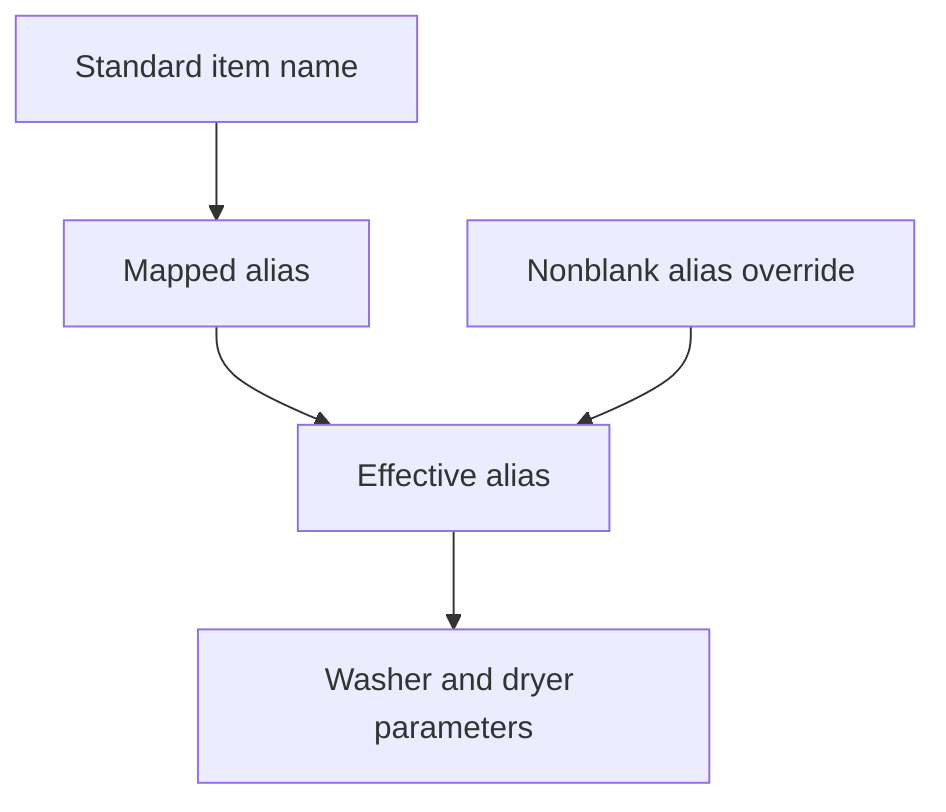

# Following a value through the system

A total is more useful when I can explain where it came from. In this system, that means following item references, service worksheets, lookups, and workbook imports—not just reading the final report.

The relationships below describe the spreadsheet implementation. They form a conceptual model reconstructed from documentation and selected formulas; they are not a relational database schema. No primary-key, foreign-key, uniqueness, or referential-integrity enforcement is assumed.

## The business records before the files

The operation deals with accounts, laundry work, items, prices, bills and status updates. Those concepts are different from the workbook or tab used to hold them.

| Concept | Meaning | Evidence boundary |
|---|---|---|
| Hotel–department account | A hotel and operating department distinguished for billing | Account-level organization is documented; a common unique account identifier has not been verified |
| Service activity and item lines | Laundry work with item quantities, dates, delivery information and line amounts | Selected worksheet fields and formulas inspected; the exact business grain of one service record still needs confirmation |
| Item reference | The item text used to retrieve a processing reference or local price | Matching expressions inspected; a globally unique item identity across domains is not established |
| Processing reference | A definition selected by an alias, supplying loading quantities and processing minutes | Selected alias and parameter lookups inspected; key uniqueness is unverified |
| Pricing reference | The item/price lookup used in a service-line amount | Central customer projections, copying source and local matching inspected; effective-date/version binding remains unverified |
| Bill / statement of account | Selected service information assembled for a billing period | Period selection inspected; one monthly workbook is not assumed to equal one bill |
| Billing status event | A timestamped update describing billing progress | Historical documentation supports status history; event identifiers and current linkage remain unverified |

The strongest inspected relationships are item-to-processing-reference matching and service-line-to-local-price matching. The broader account/service/bill/status relationships are documented context. They are not yet a formal ER schema with verified cardinalities.

### Identity and physical location are different

A service-tab number locates a worksheet inside a workbook. A row locates an item-line slot. Neither is automatically a durable business identifier across workbook copies, customers or years. Likewise, a timestamp is not necessarily a unique status-event key.

Summary workbooks, the workbook-location registry and dashboard outputs belong in the implementation and reporting views. An imported total is not a new originating service transaction, and a Paid status does not by itself establish a payment-ledger entity.

The [architecture walkthrough](architecture.md) maps these concepts to files, functions and outputs. The traces below then open up selected mechanisms. A normalized relational redesign would be separate proposed work; it is not needed to explain these existing connections.

## Observed chain: item to processing parameters

The inspected Load Parameters rows follow this dependency:

The item field references the standard-name sheet. An exact-match `VLOOKUP` maps that item to an alias. The effective-alias formula, `=if(C2<>"",C2,B2)`, chooses the override when nonblank and the mapped alias otherwise. Subsequent exact-match lookups use that effective alias against the process-details table.

This is a concrete reference-data relationship: changing the selected alias changes the lookup key for several parameters. It is not proof that overrides are valid or aliases are unique. The [production standards case study](case-studies/production-standards.md) includes the expressions and their exception behavior.

### Weight references need a separate trace

The inspected weight sheet imports its item list through configured `IMPORTRANGE` arguments and retrieves washer quantity from Load Parameters with an exact-match `VLOOKUP`. It classifies item text by checking for `KG` before `RW`. The implied-weight expression returns blank for a KG classification and otherwise selects a denominator for division by 23.

The alternate field is headed `Manual Wt`, but its units and intended use in that division remain unresolved. This is a known interpretation limit, not a demonstrated correct conversion or an established production defect.

A selected Summary consumer has now been traced to the static item and implied-weight columns. It uses those references in monthly kilogram analysis, including rewash workload that can have zero revenue. This closes one consumer gap without establishing all planning/reporting use, automatic refresh, or agreement with the dynamic section. The [standards case study](case-studies/production-standards.md) follows that path.

## Observed chain: Summary registry to consolidated output

The selected Billing Grabber expression provides a second trace:

| Step | Observed dependency |
|---|---|
| Construct a key | Concatenate `Summary - ` with the current row’s column-B value |
| Resolve the source | Exact-match `VLOOKUP` in registry columns D:E returns the workbook reference |
| Select the output | `IMPORTRANGE` reads the source billing sheet from C22 to the end of row 22 |
| Handle a missing-match result | Outer `IFNA` returns blank for an applicable `#N/A` |

The [source-derived formula exhibit](../examples/formula-exhibits.md) shows the expression. This trace establishes how the selected import resolves its location and source range. Further inspection traces selected upstream Summary cells to cycle-dependent monthly statement imports and local cutoff totals. Import freshness, every output column and all downstream uses remain unverified.

Separate `FILTER` expressions populate two configuration lists. If their source columns have different blank patterns, independent filtering could disrupt row pairing. That is a structural review concern, not an observed mismatch. The inspected totals aggregate imported numbers; aggregation alone does not establish reconciliation against an independent control total.

## Observed billing path versus documented business rule

Selected statement formulas filter service-sheet identifiers by pickup day, construct worksheet addresses, and retrieve statement fields and a service total. Selected line formulas also demonstrate price lookup and amount calculation. These inspected relationships support the [billing and collections case study](case-studies/billing-and-collections.md).

Historical documentation describes delivery-date entry as a billability gate. The selected pickup-day selection and amount path does not establish how that gate is applied. A separate delivery-date display formula exists, but its presence does not prove that the billing selector consumes it. The missing edge stays unresolved rather than being filled with an assumed control.

## What remains to trace

The broader documented flow continues through billing status, collections, financial consolidation, and executive KPIs. Current latest-status selection, event tie handling, and selected KPI source formulas remain source gaps. The dashboard export/email source has now been inspected. Historical relationships can orient the reader, but they do not complete those formula-level traces.

All observed edges here come from bounded, read-only formula inspection. No recalculation or end-to-end execution is claimed. See [verification scope](verification.md) for the consolidated record.
