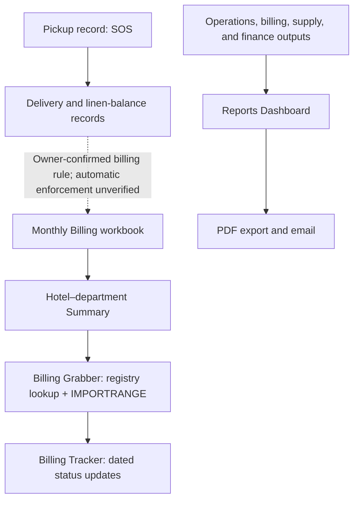

# Follow one service record through Jumpin Wash

The production system connects laundry operations, billing, collection follow-up, and management reporting across Google Workspace. This walkthrough follows the implemented workbook flow; the relational design elsewhere in this repository is a proposed model, not a deployed database.

## Workflow at a glance



*Solid paths summarize documented or inspected workflow relationships. The dashed edge is a confirmed operating rule, not verified automated enforcement. Dashboard inputs are documented; some KPI formulas and their exact lineage remain untraced.*

## One implementation detail

The inspected monthly billing formula looks up the item’s local unit price, then calculates the line amount from quantity:

```excel
=IF(ISERROR(H10*O10),"",H10*O10)
```

Here, **H** is quantity, **O** is unit price, and **P** is amount. The formula returns a blank on an error; it does not create an exception alert. See [billing and collections](case-studies/billing-and-collections.md) and the [formula exhibits](../examples/formula-exhibits.md) for the surrounding pricing and consolidation logic.

A Service Order Slip (SOS) represents one pickup form. Pickup date determines its cutoff; every item must be delivered before billing. A June 14 pickup completed June 18 stays in the June 1–15 statement, and each hotel–department has one Statement of Account per cutoff. These are owner-confirmed rules. The selected statement-formula trace does not prove automatic enforcement of the delivery gate. The [business data model](business-data-model.md#1-business-relationships) records the source basis and proposed relationships.

## Contribution, impact, and controls

- **Production system:** I built the original Google Workspace system from scratch and evolved it as operating needs changed. The project span of 2021–2026 is user-reported; the available evidence does not date or attribute every later enhancement individually.
- **Portfolio review:** In 2026, I reviewed selected formulas and Apps Script, mapped source-grounded business relationships, and prepared a proposed relational design. AI assisted the documentation and source review; it did not build the original production system.
- **Reported impact:** Workforce assessments indicated billing turnaround improved from roughly **2–3 months to under one week**, and payroll preparation from **about one workday to about two hours**. These were not controlled timing studies.
- **Existing practices and limits:** Documented workflow corrects discrepancies at the originating service record; monthly billing uses copied period price snapshots; Tracker records dated statuses. Inspection did not establish automatic delivery-gate enforcement, timestamp-based status ordering, or end-to-end reconciliation and freshness checks.

Continue with the [production standards](case-studies/production-standards.md), [executive reporting](case-studies/executive-reporting.md), and [verification scope](verification.md). The selected [Apps Script helpers and isolated checks](../src/README.md) show what was inspected and tested; they do not constitute a deployable system or a production test.
