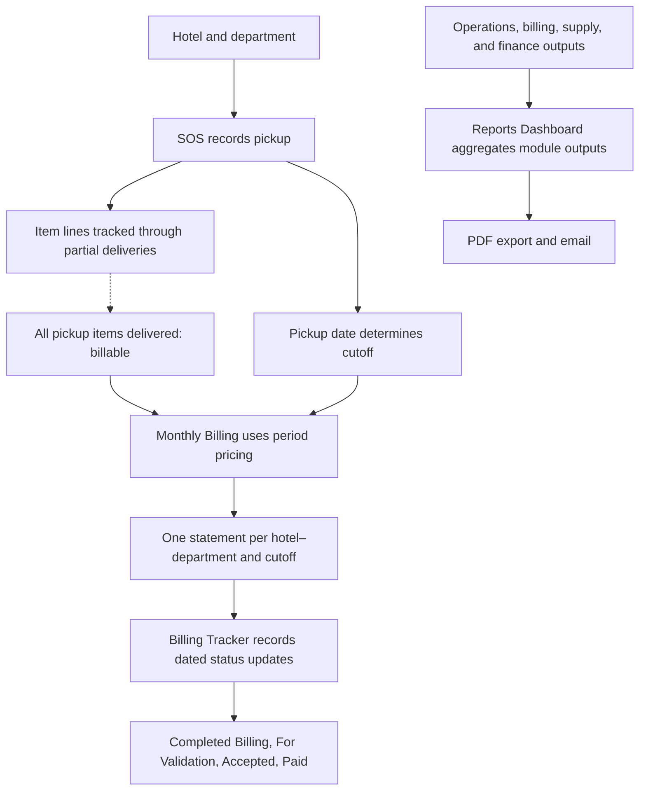

# How Jumpin Wash connects pickup, billing, collections, and reporting

Jumpin Wash is a commercial laundry serving hotels. This walkthrough follows the documented handoffs between service records, billing, and collection tracking. Management reporting is shown as an aggregate branch because a complete pickup-to-KPI trace has not been established. The relational design elsewhere in this repository is proposed analysis, not a deployed database.

## The service-to-cash flow



*The solid service-to-cash handoffs summarize documented or inspected relationships. The dashed edge is an owner-confirmed business rule; automatic enforcement is unverified. Tracker statuses are recorded updates; timestamp ordering and transition enforcement were not established. The reporting branch is separate from the service-record flow, and some KPI formulas and lineage remain untraced.*

## The two-clock billing rule

A Service Order Slip (SOS) represents one pickup form. Every item on that pickup must be delivered before billing; its pickup date still determines the cutoff. For example, a June 14 pickup completed on June 18 remains in the June 1–15 statement. Each hotel–department has one Statement of Account per cutoff. These rules are owner-confirmed. The selected statement-formula trace does not prove automatic enforcement of the delivery gate. See the [business data model](business-data-model.md#1-business-relationships) for the source basis and proposed relationships.

## One implementation detail

The inspected monthly billing formula calculates a **line amount** from quantity and unit price:

```excel
=IF(ISERROR(H10*O10),"",H10*O10)
```

Here, **H** is quantity, **O** is unit price, and **P** is amount. The surrounding billing flow looks up the item’s local unit price first. This formula returns a blank on an error; it does not create an exception alert. See [billing and collections](case-studies/billing-and-collections.md) and the [formula exhibits](../examples/formula-exhibits.md) for pricing and consolidation details.

## Contribution, impact, and controls

- **Production system:** I built the original Google Workspace system and evolved it as operating needs changed. The project span of 2021–2026 is user-reported; available evidence does not date or attribute every later enhancement individually.
- **Portfolio review:** In 2026, I reviewed selected formulas and Apps Script, mapped source-grounded business relationships, and prepared a proposed relational design. AI assisted the documentation and source review; it did not build the original production system.
- **Reported impact:** Workforce assessments indicated billing turnaround improved from roughly **2–3 months to under one week**, and payroll preparation from **about one workday to about two hours**. These were not controlled timing studies.
- **Existing practices and limits:** Documented workflow corrects discrepancies at the originating service record; monthly billing uses copied period price snapshots; Tracker records dated statuses. Inspection did not establish automatic delivery-gate enforcement, timestamp-based status ordering, or end-to-end reconciliation and freshness checks.

Continue with the [production standards](case-studies/production-standards.md), [executive reporting](case-studies/executive-reporting.md), and [verification scope](verification.md). The selected [Apps Script helpers and isolated checks](../src/README.md) show what was inspected and tested; they do not constitute a deployable system or production test.