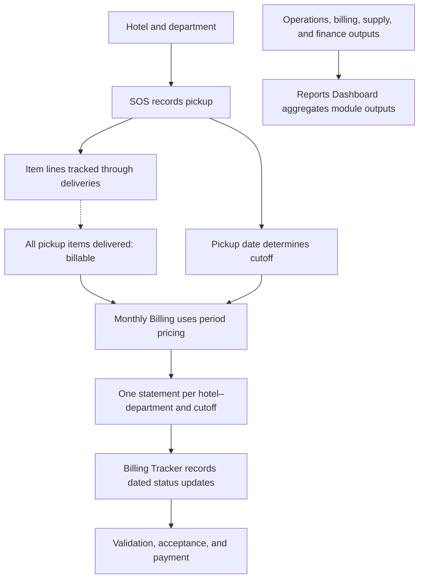
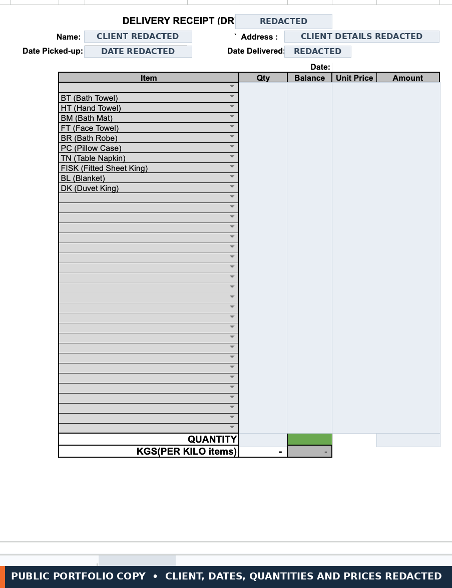
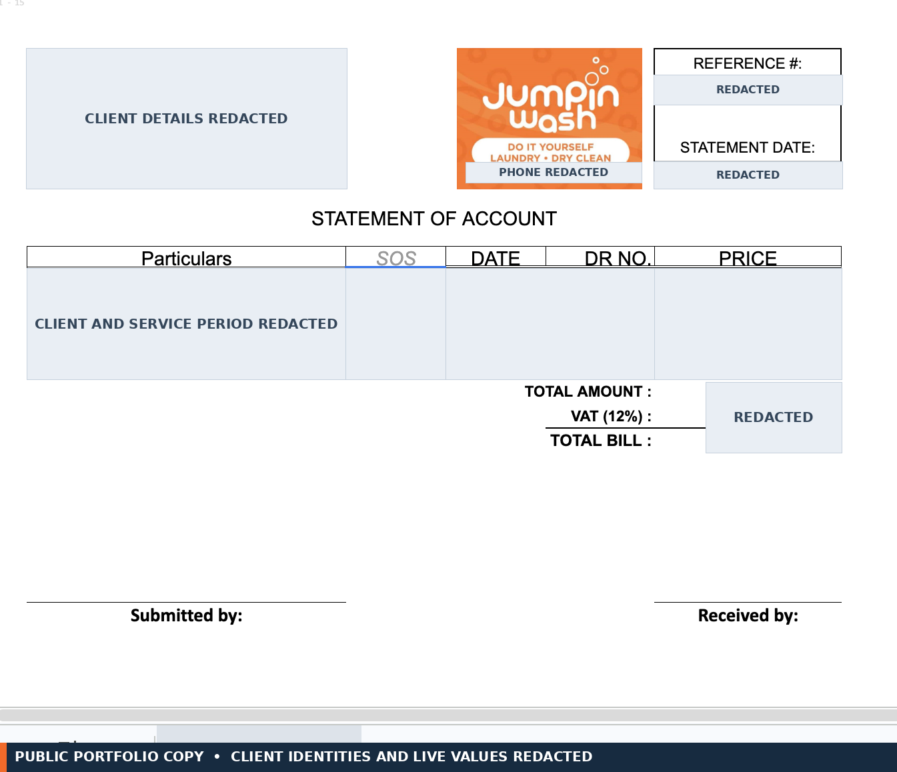

# A visual tour of Jumpin Wash's production workflow

Jumpin Wash is a commercial laundry serving hotels. Its Google Workspace system connects service records, billing, collection follow-up, and management reporting. The proposed relational design elsewhere in this repository is portfolio analysis, not a deployed database.

The screenshots below are **separate production-screen captures**, arranged to show the kinds of work the system supports. The SOS is a combined pickup-and-delivery form. These captures are not a linked record-level trace: client and transaction identifiers are redacted, so they cannot establish that the same transaction appears in every view. The diagrams and source analysis explain the documented handoffs and their verification limits.

## Service-to-management flow



*The dashed link is an owner-confirmed billing rule; automatic enforcement is unverified. Tracker statuses are recorded updates; timestamp ordering and transition enforcement were not established. The reporting branch aggregates module outputs, but some KPI formulas and lineage remain untraced.*

## Production screens

### SOS: combined pickup and delivery form



The SOS form captures pickup and delivery dates alongside item lines, quantities, balances, and service-amount fields. The screenshot’s visible form heading says “Delivery Receipt (DR).” Client and transaction values are concealed.

### Statement of Account



The statement layout includes SOS and delivery-receipt references on its service lines. Client details, service period, references, and amounts are concealed.

### Billing Tracker status history


The populated log shows `Accepted` and `For Validation` states in the tracker’s status column. Entry numbers, dates, times, account/department names, billing periods, and amounts are concealed.

### Reports Dashboard


The dashboard brings Production, Admin, and Finance views together, including delivery performance, billing pipeline, reorder, and period-comparison sections. Client identities, sensitive dates, and values are concealed. This supplied view is clipped at the right edge, so it is included here as supporting context rather than the README’s lead visual.

**Evidence boundary:** These captures show production interfaces and their visible fields/statuses. Redaction prevents matching a single transaction across screens. The captures alone do not verify a complete delivery-to-billing trace, current data freshness, reconciliation, or KPI lineage. Selected mechanisms and their limits are documented below and in [verification scope](verification.md).

## The billing problem and operating rule

The system has to coordinate item-level delivery completion with pickup-based billing cutoffs. A Service Order Slip (SOS) combines pickup and delivery information in one form. Every item on that pickup must be delivered before the pickup is billable; the pickup date determines its cutoff. For example, a June 14 pickup completed June 18 remains in the June 1–15 statement. Each hotel–department has one Statement of Account per cutoff. These are owner-confirmed business rules. The selected statement-formula trace does not prove automatic enforcement of the complete-delivery gate. See the [business data model](business-data-model.md#1-business-relationships) for the source basis and proposed relationships.

The documented workflow corrects discrepancies at the originating service record. Monthly billing uses copied period price snapshots, and Billing Tracker records dated statuses. The [controls and validation review](controls-and-validation.md) distinguishes documented practices from mechanisms verified in selected formulas or scripts.

## One implementation detail

The inspected monthly billing formula calculates a **line amount** from quantity and unit price:

```excel
=IF(ISERROR(H10*O10),"",H10*O10)
```

Here, **H** is quantity, **O** is unit price, and **P** is amount. This formula returns a blank on an error; it does not create an exception alert. See [billing and collections](case-studies/billing-and-collections.md) and the [formula exhibits](../examples/formula-exhibits.md) for pricing and consolidation details.

## Contribution, impact, and controls

- **Production system:** I built the original Google Workspace system and evolved it as operating needs changed. The project span of 2021–2026 is user-reported; available evidence does not date or attribute every later enhancement individually.
- **Portfolio review:** In 2026, I reviewed selected formulas and Apps Script, mapped source-grounded business relationships, and prepared a proposed relational design. AI assisted the documentation and source review; it did not build the original production system.
- **Reported impact:** Workforce assessments indicated billing turnaround improved from roughly **2–3 months to under one week**, and payroll preparation from **about one workday to about two hours**. These were not controlled timing studies.
- **Limits:** Inspection did not establish automatic delivery-gate enforcement, timestamp-based status ordering, or end-to-end reconciliation and freshness checks. Selected script helpers and isolated checks are not a deployable system or production test.

Continue with [production standards](case-studies/production-standards.md), [billing and collections](case-studies/billing-and-collections.md), and [executive reporting](case-studies/executive-reporting.md). The [verification scope](verification.md) explains what was inspected and tested.
