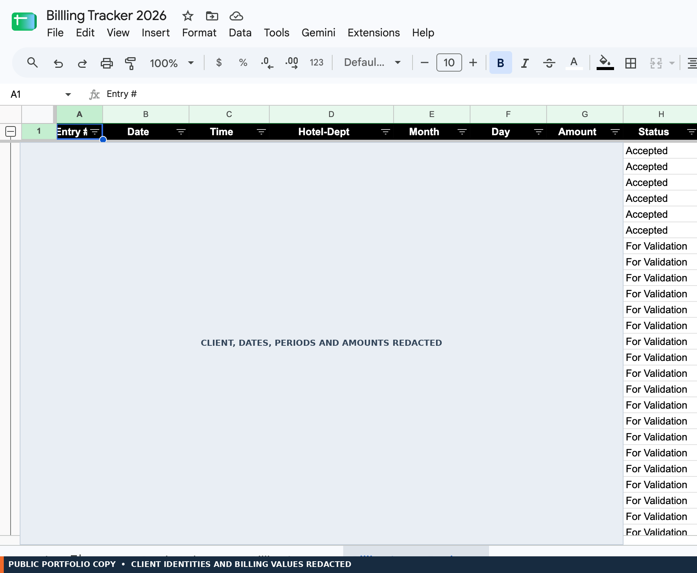
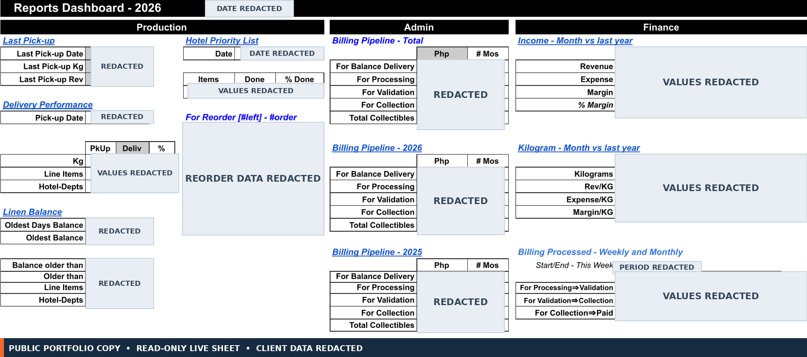

# From hotel pickup to accepted billing

Jumpin Wash is a commercial laundry serving hotels. Its live Google Workspace system supports the operating loop from pickup and delivery records through billing, collection follow-up, and management reporting.

The key control is easy to miss if the story starts with a spreadsheet formula: **the hotel does not physically accept billing documents for a pickup until every item from that pickup has been delivered.** At the same time, pickup date determines the statement cutoff. This walkthrough follows that business rule through the production screens and the source evidence.

## The operating loop

A Service Order Slip (SOS) is one combined pickup-and-delivery form. The pickup date assigns the cutoff; delivery completion determines when the billing documents can be accepted by the hotel. The statement groups service into one SOA per hotel–department and cutoff.

~~~mermaid
flowchart TD
  A["SOS records pickup and delivery"] --> B["Track item lines through delivery"]
  A --> C["Pickup date assigns cutoff"]
  B --> D["Every pickup item delivered"]
  C --> E["Prepare one SOA per hotel–department / cutoff"]
  E --> F["Hotel physically accepts billing documents"]
  D --> F
  F --> G["Billing Tracker follows validation, acceptance, payment"]
  G --> H["Reports Dashboard summarizes operations and finance"]
~~~

The hotel acceptance step is an owner-confirmed operational gate. It describes what the customer accepts; it does not, by itself, prove that a spreadsheet formula blocks internal preparation or submission. The selected formula review has not established such automatic enforcement.

## Visual walkthrough

The first exhibit pairs two production views from the same pickup. The actual reference and other identifying details are covered; “MATCHED PICKUP” is the same neutral label substituted in both views.

### 1. One pickup linked to its statement

The same service reference appears on the combined pickup-and-delivery form and the SOA line. Actual names, dates, references, quantities, prices, and amounts are hidden. The panel demonstrates a real record-to-statement connection; it does not prove that the spreadsheet automatically prevents billing before delivery is complete.

### 2. The tracker follows billing status

The status-history capture shows “Accepted” and “For Validation” entries. Identifiers, dates, times, periods, and amounts are concealed. It supports the presence of recorded statuses; it does not establish timestamp-based ordering or enforced status transitions.

### 3. The dashboard gives management an operating view

The dashboard brings Production, Admin, and Finance sections together, including delivery performance, billing pipeline, reorder, and period-comparison views. Client identities, dates, and values are redacted. The supplied capture is clipped at the right edge.

## The control that connects delivery to billing

The business rules are:

- All items on a pickup must be delivered before the hotel physically accepts billing documents for that pickup.
- Pickup date determines the statement cutoff, even if delivery finishes later. For example, a June 14 pickup completed on June 18 remains in the June 1–15 statement.
- One SOA is prepared per hotel–department and cutoff.

The first rule is the external customer-acceptance gate, confirmed by the system owner. It is a meaningful operating control even though the current source review has not proven a formula-level hard block. Do not read “hotel accepts after delivery” as proof that the workbook prevents staff from preparing or sending a document early.

## What the implementation evidence supports

| Claim | Evidence reviewed | What it establishes |
|---|---|---|
| A pickup service record can be referenced on an SOA line | Matched redacted SOS–SOA panel and source-grounded business model | Visible reference link for this example plus documented relationship; it does not prove the delivery gate is automated |
| Billing documents are accepted by the hotel after complete delivery | Owner-confirmed operating rule | External acceptance condition; spreadsheet enforcement remains unverified |
| Pickup date controls the statement period | Owner-confirmed rule and selected statement-selection formula | Cutoff logic for the reviewed path; not every workbook path |
| Billing amount uses quantity and local unit price | Selected monthly billing formula | The reviewed line amount calculation |
| Tracker records validation/acceptance states | Redacted status history and selected formulas | Visible statuses and selected current-status logic; no proof of timestamp order or transition controls |
| Dashboard brings multiple operational areas together | Redacted dashboard capture and reporting documentation | Dashboard sections and documented aggregation; some KPI formula lineage remains untraced |

The paired panel connects one service record to a statement line by a shared reference. It does not verify current data freshness, execution of reconciliation, automatic delivery gating, or dashboard KPI lineage. The tracker and dashboard are separate production captures and are not linked to this same record.

## One formula, in context

The selected monthly billing formula calculates a line amount from quantity and unit price:

~~~excel
=IF(ISERROR(H10*O10),"",H10*O10)
~~~

Here, H is quantity, O is unit price, and P is amount. The formula displays blank if its multiplication errors; it does not create an exception alert. The selected statement path and its delivery-gate evidence are discussed in [billing and collections](case-studies/billing-and-collections.md) and the [formula exhibits](../examples/formula-exhibits.md).

## Impact and contribution

Workforce assessments indicated billing turnaround moved from roughly **2–3 months to under one week**, and payroll preparation from **about one workday to two hours**. These are reported assessments, not formal timing-study results.

I built the original Google Workspace production system and evolved it as operating needs changed. The 2021–2026 project span is user-reported; available evidence does not date or attribute every enhancement individually. In 2026, I reviewed selected formulas and Apps Script, mapped source-grounded business relationships, and documented a proposed relational design. AI assisted this portfolio review; it did not build the original system.

## Continue exploring

- [Billing and collections](case-studies/billing-and-collections.md): monthly workbooks, customer pricing, consolidation, and tracker behavior.
- [Production standards](case-studies/production-standards.md): shared item references and processing parameters.
- [Executive reporting](case-studies/executive-reporting.md): management outputs and KPI lineage limits.
- [Controls and validation](controls-and-validation.md): documented operating practices, inspected mechanisms, and proposed checks.
- [Verification scope](verification.md): what was inspected and tested.

The relational design elsewhere in this repository is portfolio analysis, not a deployed database. Selected Apps Script helpers and isolated checks are not a deployment package or production test.